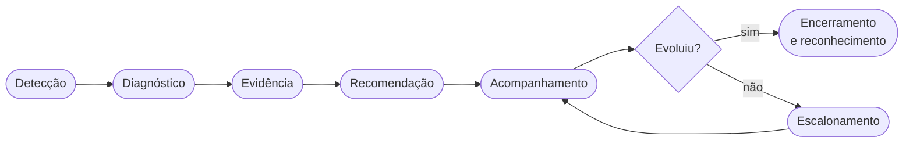
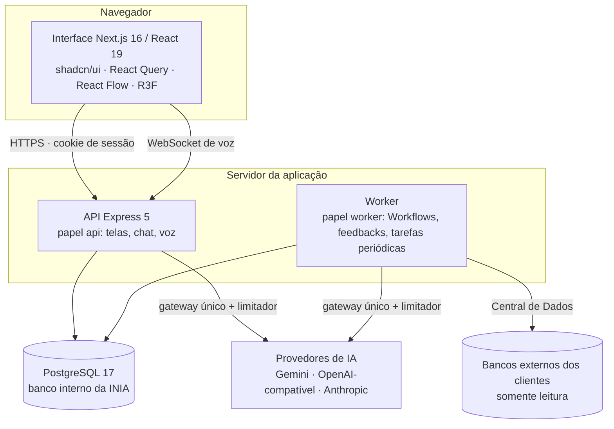

<div align="center">

# INIA

### Supervisora Virtual com IA para operações de atendimento

Detecta sinais operacionais, reúne evidências verificáveis, produz diagnósticos explicáveis, recomenda ações,
acompanha a evolução de cada pessoa e escala quando é preciso.


</div>

---

> **A INIA não é um chatbot.** É uma supervisora: observa a operação, encontra o que merece atenção, prova o que
> encontrou com fontes verificáveis e conduz o desenvolvimento das pessoas — do primeiro sinal até o encerramento do
> caso. A conversa (texto e voz) é só uma das portas de entrada.

## Sumário

- [Como a INIA trabalha](#como-a-inia-trabalha)
- [Funcionalidades](#funcionalidades)
- [Arquitetura](#arquitetura)
- [Stack](#stack)
- [Estrutura do repositório](#estrutura-do-repositório)
- [Começo rápido](#começo-rápido)
- [Instalação completa](#instalação-completa)
- [Conectar um banco de dados externo](#conectar-um-banco-de-dados-externo)
- [Atualizar, produção e comandos](#atualizar-uma-instalação-existente)
- [Desenvolvimento e testes](#desenvolvimento-e-testes)
- [Publicar no GitHub](#publicar-no-github)
- [Segurança](#segurança)
- [Documentação](#documentação)

## Como a INIA trabalha

Toda atuação segue a mesma jornada, e tudo o que acontece nela pertence a um **caso de supervisão**
(`SupervisionCase`): alertas, evidências, feedbacks, planos de desenvolvimento, checkpoints e escalonamentos.



**Dois tipos de feedback**

| Tipo | Baseado em |
| --- | --- |
| `INDICATOR` | Indicador, meta vigente, período, evolução, contexto operacional e histórico da pessoa. |
| `MONITORING` | Interação/transcrição, critérios de monitoria, base de conhecimento vigente, guardrails e diagnósticos relacionados. |

Um feedback só é publicável com **indicador impactado, evidência encontrada, comportamento observado, procedimento
relacionado e recomendação**.

**Escalonamento progressivo:** `OBSERVE` → `ORIENT` → `COACH` → `ACTION_PLAN` → `MANAGER`. Um resultado abaixo da meta,
sozinho, não escala ninguém: a decisão considera causa, recorrência, evidências, evolução e intervenções anteriores.
Bons resultados também geram elogio e reconhecimento.

**Princípios que o código aplica (não só o prompt):**

- **Texto gerado por IA nunca é evidência.** A evidência de um feedback de monitoria precisa ser uma citação literal da
  transcrição de origem; se a IA resumir ou parafrasear, o resultado é descartado.
- **Comportamentos, nunca códigos.** Indicadores e domínios de negócio são dados administráveis: a aplicação conhece
  estratégias de agregação, unidades e tipos de especialidade, nunca `TMA`, `FCR` ou `FATURAMENTO` no código.
- **Escopo vem do servidor.** O que cada pessoa vê é decidido pela posição na estrutura e pelos papéis de acesso, no
  backend, a cada requisição.
- **Uso real é persistido.** Conversas com a INIA, execuções de agentes (entrada, saída, status, erro) e avaliações de
  feedback ficam no banco, para que as IAs possam ser avaliadas e evoluir a partir do histórico.

## Funcionalidades

| Área | O que entrega |
| --- | --- |
| **Motor de feedback** | Análise de chamadas e investigação de indicadores, práticas e temas, firmeza calibrada, memória do motor e entrega única no Acompanhamento. |
| **Workflows visuais** | Editor em grafo com gatilho, espera, condição, seleção de colaboradores, aplicação individual, consolidação, ação, orquestrador, revisão humana e saída. Validação de publicação, execução manual ("Executar agora") e worker concorrente. |
| **Agents e Orquestradores** | Agentes especialistas por domínio de negócio, com contexto, restrições, base de conhecimento e Tools de investigação somente leitura; orquestradores com política de roteamento e resultado estruturado. |
| **Diagnóstico de indicador** | Estratégia de diagnóstico por indicador, com versões (rascunho e publicada), pino de versão por execução e "Testar diagnóstico". |
| **Acompanhamento, Pendências e Sino** | Conteúdo para ler, ação requerida e "algo novo aconteceu", que nunca se misturam. Ciência formal do colaborador com login e senha. Conteúdo gerado sempre renderizado em Markdown seguro. |
| **Conversa com a INIA** | Chat persistido e voz em tempo real (Gemini Live), com avatar 3D (React Three Fiber) e lip-sync em português. "Ouvir com a INIA" aplica um feedback em conversa. |
| **Central de Dados** | Uma porta de entrada para os dados do cliente: arquivos, APIs e bancos externos (SQL Server, PostgreSQL, MariaDB, MySQL) com contratos, quarentena, lineage, disponibilidade D-1/D-2, situação funcional e calendário operacional (escalas 5x2/6x1, feriados). |
| **Indicadores e Equipe** | Catálogo de indicadores orientado a metadados, medições diárias × fechamentos oficiais, PRV, comparação operacional e organograma "Minha estrutura". |
| **Camada de IA** | Provedores e modelos administráveis (Google Gemini, APIs compatíveis com OpenAI — inclusive modelos locais — e Anthropic), roteamento por caso de uso, limitador de chamadas, uso, custo e orçamento. |
| **Acesso** | Contas × papéis × permissões × escopos, delegação, liberação de acesso com senha temporária e troca obrigatória no primeiro login. |
| **Operação do produto** | QA Lab (simulação de Workflows com banco somente leitura), monitoria de usabilidade e uma Wiki oficial do produto em `/wiki`. |

## Arquitetura



- **Backend** organizado por domínio em `backend/src/modules/<domínio>/{domain,application,infrastructure,presentation,testing}`.
  O mesmo processo pode rodar API e processamento juntos (`all`, padrão) ou separados (`api` / `worker`).
- **Frontend** com `app/` só para rotas; cada funcionalidade tem `components/`, `queries/`, `services/` e `schemas/`
  próprios, com tipos derivados do zod (`z.infer`).
- **Execução de agentes** atrás de uma interface única: trocar de provedor de LLM não exige mudança em outra parte do
  sistema. Prompts, esquemas de resposta e versões são contratos versionados.
- **Banco interno sempre PostgreSQL**, evoluído por migrations (121 até agora). Dados de demonstração nunca entram por
  migration: só por seed explícito, recusado em produção.

## Stack

| Camada | Tecnologias |
| --- | --- |
| Frontend | Next.js 16, React 19, TypeScript, Tailwind CSS, shadcn/ui (Radix), TanStack Query, React Flow (`@xyflow/react`), Recharts, Three.js + React Three Fiber, react-markdown, Motion, zod |
| Backend | Node.js 24, Express 5, TypeScript, PostgreSQL (`pg`), zod, pino, helmet, bcrypt, JWT, multer, ExcelJS, leitura de PDF e DOCX |
| Conectores externos | `mssql`, `pg`, `mysql2` (MariaDB e MySQL), `ssh2` |
| IA | Gemini (texto e Live/áudio nativo), adaptadores compatíveis com OpenAI e Anthropic |
| Qualidade | Vitest, Testing Library, Supertest, ESLint |
| Infra | Docker Compose (banco interno e bancos de exemplo), IIS + WinSW para Windows Server |

## Estrutura do repositório

```text
inia/
├── backend/                 API e worker (Express + TypeScript)
│   ├── src/
│   │   ├── modules/         um diretório por domínio (workflows, feedback-engine, data-hub, agents…)
│   │   ├── shared/          código compartilhado por camada
│   │   ├── infrastructure/  banco, migrations runner, seeds, instalação
│   │   └── main/            composição da aplicação e servidor
│   ├── migrations/          evolução estrutural do banco interno (SQL)
│   ├── seeds/               dados de demonstração (só via seed explícito)
│   └── scripts/             utilitários de desenvolvimento e avaliação
├── frontend/                interface web (Next.js)
│   ├── src/app/             rotas (App Router), incluindo a Wiki em /wiki
│   ├── src/components/      componentes por funcionalidade + kit de UI (shadcn)
│   ├── src/{queries,services,schemas,lib}/
│   └── public/              ativos estáticos (inclui o modelo 3D do avatar)
├── scripts/install/         instalação: doctor, env:init, db:connect, run
├── scripts/github/          publicação no GitHub sem o histórico local (github:publish)
├── docker/                  imagens dos bancos externos de exemplo
├── deploy/windows/          IIS e serviços do Windows (WinSW)
├── tools/                   pipeline do avatar (Blender/Python) e captura de fixtures de voz
├── docs/                    arquitetura (ADRs), notas técnicas, segurança e instalação
└── compose.yaml             PostgreSQL interno + bancos externos de exemplo
```

## Começo rápido

Com Node.js 24+ e Docker:

```bash
npm run install:all
```

```bash
npm run env:init
```

```bash
npm run db:up
```

```bash
npm run setup
```

```bash
npm run dev
```

Abra <http://localhost:3000> e entre com o e-mail do administrador e a senha temporária mostrada no fim do `setup`.
O passo a passo completo, com alternativas, está logo abaixo.

---

## Instalação completa

> **Dois tipos de banco de dados — não confunda**
>
> | | Banco **interno** da INIA | Bancos **externos** (dos clientes) |
> | --- | --- | --- |
> | O que é | Onde a INIA guarda os próprios dados | SQL Server, PostgreSQL, MariaDB ou MySQL de onde a INIA **lê** dados |
> | Tecnologia | Sempre PostgreSQL 17+ | SQL Server, PostgreSQL, MariaDB, MySQL |
> | Onde se configura | `DATABASE_URL` no `backend/.env`, na instalação | Pela tela **Administração › Central de Dados › Conectar banco de dados** |
> | Quem cria as tabelas | As migrations da INIA (`npm run setup` / `npm run update`) | Ninguém: a INIA nunca cria nem altera nada nos bancos externos |

### Pré-requisitos

| Item | Versão | Para quê |
| --- | --- | --- |
| Git | qualquer recente | baixar o repositório |
| Node.js | **24 ou mais novo** (inclui o npm) | backend e frontend |
| Docker com Compose v2 | Docker Desktop, Colima ou Docker Engine | subir o PostgreSQL interno (recomendado) e os bancos de exemplo |
| *ou* PostgreSQL | **17 ou mais novo** | se preferir usar um PostgreSQL próprio em vez do Docker |

O banco **interno** da INIA é sempre PostgreSQL — a aplicação não roda sobre SQL Server, MySQL ou MariaDB. Se a
empresa só tem SQL Server, instale um PostgreSQL ao lado — inclusive num servidor da área de dados (veja
[Instalação em dois servidores](#instalação-em-dois-servidores-windows-server--iis)) — e conecte o SQL Server como banco
**externo** pela Central de Dados, de onde a INIA lê os dados.

Portas usadas: `3000` (aplicação), `3333` (API), `5432` (PostgreSQL do Docker — se já estiver ocupada, a instalação
escolhe a próxima livre). Para os bancos externos de exemplo: `55432`, `53306`, `53307`, `51433`.

### Passo a passo

A INIA não vem com nenhum usuário pronto: no passo 5 você cria o **primeiro administrador** (nome e e-mail) e recebe
uma senha temporária para o primeiro acesso. Detalhes em
[O administrador e o acesso da equipe](#o-administrador-e-o-acesso-da-equipe).

```bash
git clone <URL-do-repositório> inia
```

```bash
cd inia
```

1. Instale as dependências do backend e do frontend:

```bash
npm run install:all
```

2. Gere os arquivos de ambiente com segredos aleatórios (`.env` da raiz, `backend/.env` e `frontend/.env.local`). Nada
   é sobrescrito se já existir. **Nenhum segredo vive no código ou no Git**: tudo o que é senha ou chave nasce aqui.

```bash
npm run env:init
```

   - Já tem um PostgreSQL rodando na porta 5432? Não precisa fazer nada: o comando percebe e usa a próxima porta livre
     para o PostgreSQL do Docker (e avisa qual).
   - Vai usar um PostgreSQL próprio (sem Docker), na mesma máquina ou em outro servidor? Use
     `npm run env:init -- --own-postgres` e depois `npm run db:connect`, que pergunta servidor, banco, usuário e senha,
     confere tudo e grava no `backend/.env`.

3. Suba o banco interno da INIA (pule se usa PostgreSQL próprio):

```bash
npm run db:up
```

4. Confira se está tudo pronto (não altera nada):

```bash
npm run doctor
```

5. Instale: cria as tabelas, os dados essenciais, a organização e o primeiro administrador. O comando pergunta o nome
   da organização, o fuso horário da operação e o nome/e-mail do administrador.

```bash
npm run setup
```

   No fim aparece uma **senha temporária** (só nessa hora). Anote: ela vale 72 horas.
   Sem terminal interativo, passe tudo por opção:
   `npm run setup -- --org-name "Minha Empresa" --timezone America/Sao_Paulo --admin-name "Nome Completo" --admin-email nome@empresa.com.br`

6. Inicie a aplicação (API e interface juntas; `Ctrl+C` encerra as duas):

```bash
npm run dev
```

7. Abra <http://localhost:3000>, entre com o e-mail do administrador e a senha temporária. A INIA pede que você crie a
   sua própria senha no primeiro acesso. Depois disso, cadastre a equipe em **Administração › Usuários e acessos** e
   os dados em **Administração › Central de Dados**.

**Inteligência artificial:** os recursos de IA (feedbacks, chat e voz) precisam de uma chave em `GEMINI_API_KEY` no
`backend/.env` (reinicie a API depois) ou de um provedor cadastrado em **Administração › IA**. Sem isso, o restante da
INIA funciona normalmente.

### Instalação em dois servidores (Windows Server + IIS)

Quando a INIA roda num servidor (área de aplicação) e o banco dela fica em outro (área de dados), as pessoas acessam um
endereço só, atendido pelo IIS, e a API e a interface ficam apenas em `127.0.0.1`:

```bash
node scripts/install/env-init.mjs --own-postgres --public-url https://inia.empresa.local
```

```bash
npm run db:connect
```

Depois, `npm run doctor`, `npm run setup` e `npm run build`; a publicação usa os scripts de
[deploy/windows](deploy/windows) (`iis/configurar-iis.ps1` e `servicos/instalar-servicos.ps1`, que cria os serviços
do Windows com o WinSW). O passo a passo — PostgreSQL na área de dados (15 no Windows Server 2016, 17 no 2019/2022),
login somente leitura no SQL Server dos clientes, preparação do Windows Server, IIS, serviços e primeiro acesso — está
em [docs/instalacao/dois-servidores-windows.md](docs/instalacao/dois-servidores-windows.md).

Sem proxy na frente, a alternativa é abrir duas portas no servidor da aplicação:
`node scripts/install/env-init.mjs --own-postgres --app-url http://srv-app:3000 --api-url http://srv-app:3333`.

### O que a instalação cria

Só o essencial: a estrutura de tabelas (migrations), os catálogos de referência (capitais e feriados), a organização
com o fuso da operação e o primeiro administrador. **Não há usuários nem senhas padrão.**

### O administrador e o acesso da equipe

- **Quem é:** o `npm run setup` cria o primeiro usuário como **Administrador geral** — acesso a toda a Administração,
  inclusive liberar o acesso das outras pessoas. Rodar o `setup` sem criar o administrador não é possível.
- **E-mail:** é só o login. A INIA não envia e-mail nenhum (nem convite, nem recuperação de senha); use o e-mail
  corporativo de quem vai administrar.
- **Senha temporária:** aparece uma única vez no fim do `setup`, vale 72 horas (`TEMPORARY_PASSWORD_TTL_HOURS` no
  `backend/.env`) e só serve para o primeiro login, que obriga a criar a senha definitiva.
- **Perdeu a senha temporária ou ela venceu?** Crie outro Administrador geral, com outro e-mail:

```bash
npm run admin:create -- --name "Nome Completo" --email outra.pessoa@empresa.com.br
```

  Esse novo administrador pode gerar uma nova senha temporária para o primeiro em **Administração › Usuários e
  acessos › Acessos** (ação "Nova senha temporária").
- **A equipe:** as pessoas entram pela Central de Dados (cadastro de colaboradores) ou em **Usuários e acessos ›
  Pessoas**, mas cadastro não é login. Para cada pessoa que vai usar a INIA, o administrador clica em **Habilitar
  acesso** (aba Acessos) e recebe uma senha temporária para entregar a ela; no primeiro login a pessoa cria a própria
  senha. O que cada um vê vem da posição na estrutura (operador, supervisor…); quem vai administrar algo também
  precisa de um papel de acesso, atribuído na mesma aba.

### Dados de demonstração (opcional)

Para avaliar a INIA com uma operação fictícia completa (milhares de colaboradores, medições e conversas), instale num
banco **vazio e separado** com `npm run setup -- --demo`. Todas as contas de demonstração usam uma senha só, a de
`INIA_DEMO_PASSWORD` no `backend/.env` (o `npm run env:init` gera uma aleatória; sem ela a carga é recusada). Nunca
use uma instalação de demonstração com dados reais. A demonstração é recusada em `NODE_ENV=production` e numa
instalação feita sem ela.

## Conectar um banco de dados externo

Depois de entrar como administrador:

1. **Administração › Central de Dados › Conectar banco de dados**.
2. Escolha o banco (SQL Server, PostgreSQL, MariaDB ou MySQL), informe servidor, porta, banco, usuário e senha e
   clique em **Testar conexão**.
3. Escolha a tabela ou visão, o conjunto de dados da INIA que ela alimenta e como ler (incremental pelo campo de
   atualização, ou leitura completa).
4. Confira a amostra e o mapeamento sugerido, valide, escolha a frequência e ative.

Recomendações: use um usuário **somente leitura** no banco do cliente; a conexão parte do **servidor onde a API da
INIA roda** (bancos em rede privada precisam estar acessíveis a partir dele). As senhas das conexões ficam cifradas no
banco com `DATA_HUB_SECRET_KEY`, que vive só no `backend/.env`. Detalhes técnicos em
[docs/dev/central-de-dados-bancos-externos.md](docs/dev/central-de-dados-bancos-externos.md).

### Bancos externos de exemplo (para experimentar)

```bash
npm run examples:up
```

Sobe um PostgreSQL, um MariaDB e um MySQL com o banco `inia_exemplo` (tabelas `colaboradores`, `medicoes_diarias` e
a visão `vw_colaboradores_em_producao`, mais `grupos`, `subgrupos`, `metas`, `fechamento_mensal` e `chamadas` com
transcrição — o que uma instalação limpa precisa para chegar ao primeiro feedback; roteiro em
[docs/instalacao/primeiro-feedback-exemplo](docs/instalacao/primeiro-feedback-exemplo/README.md)) e o usuário somente
leitura `inia_leitura`. A senha dele é o valor de
`INIA_EXAMPLES_READER_PASSWORD` no `.env` da raiz — gerada pelo `npm run env:init` (ou pelo próprio `examples:up`, se
faltar). Use servidor `localhost` e a porta do banco: PostgreSQL `55432`, MariaDB `53306`, MySQL `53307`.

O SQL Server de exemplo (porta `51433`, mesmo banco, usuário e senha) tem comando próprio:

```bash
npm run examples:sqlserver:up
```

Ele só existe para processadores x86: em Mac com Apple Silicon o Docker precisa do Rosetta (instale com
`softwareupdate --install-rosetta` e, no Colima, `colima start --vm-type vz --vz-rosetta`). Subir o SQL Server aceita a
licença do SQL Server Developer (uso de teste). Para parar todos os exemplos: `npm run examples:down`.

## Atualizar uma instalação existente

```bash
git pull
```

```bash
npm run install:all
```

```bash
npm run update
```

O `update` aplica **somente as migrations pendentes** (cada uma na própria transação) e confere os dados de referência.
Nada é apagado. Em produção, faça backup do banco interno antes. Depois, reinicie a aplicação (e rode `npm run build`
se usa o modo de produção).

## Produção

- `NODE_ENV=production` no `backend/.env`: exige `JWT_SECRET` e `DATA_HUB_SECRET_KEY` próprios e cookies seguros, ou
  seja, **a aplicação precisa estar atrás de HTTPS** (IIS, Nginx ou um balanceador). O microfone da conversa por voz
  também só funciona com HTTPS.
- O jeito mais simples é o endereço único: `node scripts/install/env-init.mjs --public-url https://…` configura tudo
  (`CORS_ORIGIN`, `NEXT_PUBLIC_INIA_API_URL`, API e interface só em `127.0.0.1`) e o proxy manda `/api` e `/health` para
  a API e o resto para a interface — no Windows Server, ver [deploy/windows](deploy/windows).
- Compile e inicie: `npm run build` e depois `npm start` (ou os serviços do Windows). O endereço público é embutido no
  build: mudou o endereço, compile de novo.
- Para separar o processamento das telas, rode dois processos: `npm --prefix backend run start:api` e
  `npm --prefix backend run start:worker`.
- Guarde `DATA_HUB_SECRET_KEY` junto dos backups: ela decifra as senhas dos bancos externos e não fica no banco.

### Por que o Docker Compose só sobe os bancos

O `compose.yaml` disponibiliza o que costuma ser difícil de instalar igual em toda máquina: o **PostgreSQL interno**
(com volume persistente e verificação de saúde) e, opcionalmente, **bancos externos de exemplo** já populados. Backend e
frontend rodam com Node.js (`npm run dev` / `npm start`) porque o frontend embute o endereço da API no build, o modo de
produção exige HTTPS e o desenvolvimento fica mais simples sem rebuild de imagem a cada mudança. Quem tem um
PostgreSQL próprio não precisa de Docker.

## Comandos

| Comando | O que faz |
| --- | --- |
| `npm run install:all` | Instala as dependências do backend e do frontend (versões travadas). |
| `npm run env:init` | Cria os arquivos de ambiente com segredos aleatórios (nunca sobrescreve). `--public-url …` grava o endereço único (IIS/proxy na frente); `--app-url … --api-url …`, duas portas abertas. |
| `npm run db:up` / `npm run db:down` | Sobe / para o PostgreSQL interno no Docker. |
| `npm run db:connect` | Aponta para um PostgreSQL em outro servidor: confere rede, senha, versão, permissões e extensões e grava no `backend/.env`. |
| `npm run doctor` | Confere pré-requisitos, ambiente e banco, sem alterar nada. |
| `npm run setup` | Primeira instalação num banco vazio (`-- --demo` para demonstração). |
| `npm run update` | Atualização: só migrations pendentes, preservando os dados. |
| `npm run admin:create` | Cria outro administrador geral com senha temporária. |
| `npm run dev` | API e interface em modo desenvolvimento. |
| `npm run build` / `npm start` | Compila e inicia em modo produção. |
| `npm run examples:up` / `npm run examples:down` | Bancos externos de exemplo (PostgreSQL, MariaDB, MySQL) para a Central de Dados. |
| `npm run examples:sqlserver:up` | SQL Server de exemplo (x86; em Apple Silicon, com Rosetta). |
| `npm run github:publish` | Publica o código atual no repositório privado do GitHub, sem o histórico local (`-- --simular` só mostra o resumo). |

### Problemas comuns

| Sintoma | O que fazer |
| --- | --- |
| `npm run doctor` diz que "outro PostgreSQL responde na porta" (ou `db:up` acusa porta em uso) | Já existe PostgreSQL na máquina nessa porta. Troque só a porta (senhas mantidas): `npm run env:init -- --postgres-port 5433` e depois `npm run db:up`. |
| `setup` diz que o banco já tem tabelas | A primeira instalação exige banco vazio. Instalação existente: `npm run update`. |
| A senha temporária venceu ou se perdeu | `npm run admin:create` cria outro administrador; ele gera uma nova senha temporária para o primeiro pela tela (ver "O administrador e o acesso da equipe"). |
| Portas 3000/3333 já em uso | No `backend/.env`: `PORT=3433` e `CORS_ORIGIN=http://localhost:3100`; no `frontend/.env.local`: as duas URLs da API com a porta 3433; e inicie com `INIA_WEB_PORT=3100 npm run dev`. |
| Login não mantém a sessão | Em `NODE_ENV=production` é preciso HTTPS. Para uso local, mantenha `NODE_ENV=development`. |
| Banco externo: "não foi possível conectar" | A conexão sai do servidor da API: confira endereço, porta, firewall/VPN a partir desse servidor. |
| `setup -- --demo` ou `db:seed:demo` pede `INIA_DEMO_PASSWORD` | Defina a senha das contas demo no `backend/.env` (8+ caracteres). Numa instalação nova, o `npm run env:init` já gera. |
| Banco de exemplo criado antes das senhas saírem do código não aceita a senha nova | Recrie os contêineres de exemplo (são só dados fictícios): `docker compose --profile external-examples rm -sfv example-postgres example-mariadb example-mysql` e `npm run examples:up`. |

### Limitações conhecidas

- Uma instalação atende **uma organização**.
- Bancos externos: a INIA lê tabelas e visões escolhidas na tela (não aceita SQL livre) e só com usuário/senha do
  próprio banco (sem autenticação integrada do Windows/Kerberos ou Azure AD).
- Bancos externos testados de ponta a ponta: PostgreSQL 17, MariaDB 11.4 e MySQL 8.4. O SQL Server está implementado,
  mas ainda não foi validado contra um servidor real — valide com o exemplo antes de usar em produção.

## Desenvolvimento e testes

```bash
cd backend && npm run lint && npm run typecheck && npm test && npm run build
```

```bash
cd frontend && npm run lint && npm run typecheck && npm test && npm run build
```

A suíte tem centenas de arquivos de teste no backend e no frontend (Vitest, Testing Library e Supertest), com limite
de tempo por teste (20 s no backend, 15 s no frontend) para que um teste travado falhe em vez de segurar a suíte.

**Provas contra banco real** ficam desligadas na execução normal e são ligadas por variável. Elas precisam de
`TEST_DATABASE_URL` com as migrations aplicadas (`npm --prefix backend run db:migrate:test`):

- Qualquer prova: `INIA_DB_PROOF=1 NODE_ENV=test npx vitest run <nome-da-prova>`.
- Instalação do zero (banco vazio → setup → update), num banco próprio que ela cria e apaga:
  `INIA_DB_PROOF=1 NODE_ENV=test npx vitest run installation-proof`.
- Bancos externos, usando os exemplos do Compose: exporte `INIA_EXAMPLES_ADMIN_PASSWORD` e
  `INIA_EXAMPLES_READER_PASSWORD` (do `.env` da raiz) e rode
  `INIA_DB_PROOF=1 INIA_EXTERNAL_DB_PROOF=1 NODE_ENV=test npx vitest run external-database-proof` (sem o SQL Server de
  exemplo, acrescente `INIA_EXTERNAL_DB_ENGINES=POSTGRESQL,MARIADB,MYSQL`).
- Bootstrap da massa demo do zero, duas vezes, num banco descartável: `DEMO_SEED_CHECK=1 npx vitest run seed-demo-from-scratch`.

Convenções de código (camadas, nomes, onde fica cada coisa) estão em [CLAUDE.md](CLAUDE.md) e em
[docs/dev/refatoracao-progressiva.md](docs/dev/refatoracao-progressiva.md).

## Publicar no GitHub

O repositório do GitHub recebe só o código atual, nunca o histórico local (que guarda manuais, fontes do avatar,
transcrições e saídas de benchmark). Com a árvore de trabalho limpa e o `gh` autenticado (`gh auth login`), confira
primeiro e depois publique:

```bash
npm run github:publish -- --simular
```

```bash
npm run github:publish
```

O comando monta a cópia do `HEAD` sem o que lista [scripts/github/exclusoes.txt](scripts/github/exclusoes.txt), barra
arquivos de segredo pelo nome, os valores dos `.env` locais e padrões de chave (AIza…, sk-…, ghp_…, chave privada,
JWT), mostra o resumo (arquivos, tamanho e o que muda em relação ao `main` do GitHub) e pede confirmação. Cada envio
vira um commit novo sobre o `main` do GitHub, enviado por URL com a credencial do `gh` e sem `--force` — o repositório
local não tem remote. `-- --verificar` roda typecheck, lint e testes numa cópia do snapshot antes de perguntar. Testes
do próprio comando: `node --test scripts/github/*.test.mjs`.

## Segurança

- **Sem segredos no repositório.** Chaves, senhas e tokens vivem só nos arquivos `.env` (fora do Git), gerados pelo
  `npm run env:init`. Isso inclui a senha das contas de demonstração e as dos bancos de exemplo; as contas que as
  migrations antigas criam nascem com senha aleatória. Os únicos valores de senha no código são fixtures dos testes
  automatizados, que usam bancos de teste descartáveis.
- **Produção é estrita:** recusa `JWT_SECRET` e `DATA_HUB_SECRET_KEY` padrão e dados de demonstração, e exige cookies
  seguros.
- **Sessão e escopo no servidor:** sessão com identificador revogável, nível de acesso verificado a cada requisição,
  conferência de origem nas escritas (proteção contra CSRF) e escopo de dados sempre decidido pelo backend.
- **Integrações sob controle:** bancos externos só leitura e com credenciais cifradas; política de destinos de saída e
  limites de arquivos.
- A auditoria completa, com mapa de superfícies, achados e configuração segura, está em [docs/security](docs/security).

## Documentação

| Onde | O quê |
| --- | --- |
| [docs/architecture](docs/architecture) | ADRs: avatar conversacional, catálogo de indicadores orientado a metadados, provedores de IA (roteamento e custos). |
| [docs/dev](docs/dev) | Notas técnicas por área: motor de feedback, Central de Dados, domínios de negócio, provedores de IA, Workflows-modelo, massa demo e mais. |
| [docs/dev/memoria](docs/dev/memoria) | Memória técnica por área (decisões, versões, provas e limitações). |
| [docs/security](docs/security) | Auditoria de segurança e guia de configuração segura. |
| [docs/instalacao](docs/instalacao) | Instalação em dois servidores Windows (aplicação + dados). |
| [docs/regras-produto-ui-ux.md](docs/regras-produto-ui-ux.md) | Regras de produto e de interface. |
| [docs/arquitetura-evolutiva-inia.md](docs/arquitetura-evolutiva-inia.md) | Visão de arquitetura e evolução. |
| `/wiki` (na aplicação) | Documentação oficial do produto para quem usa a INIA. |

---

<div align="center">
<sub>Repositório privado · INIA — Supervisora Virtual com IA</sub>
</div>
