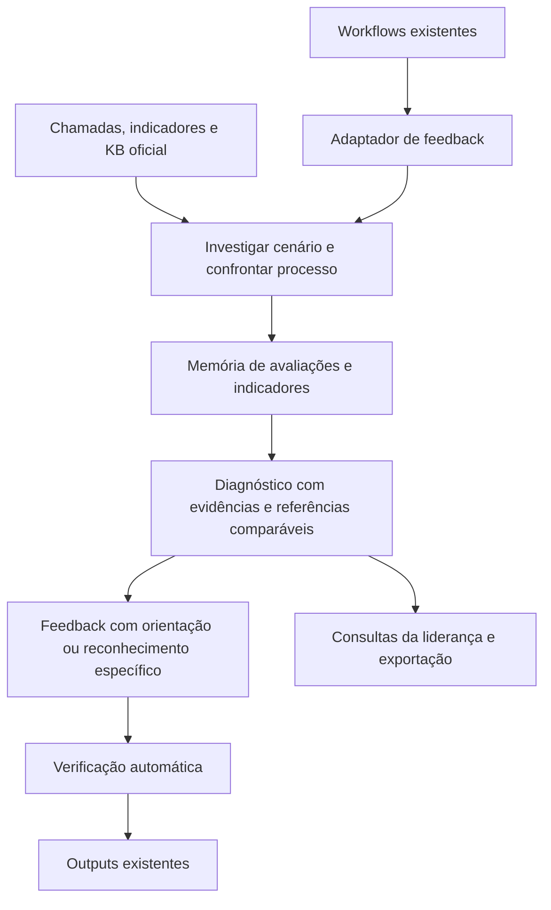

# Mapeamento da arquitetura de feedback da INIA

Data: 30/09/2026. Referência: checkout local em `b3d409a`, incluindo alterações ainda não commitadas. Escopo: leitura do anexo, código, migrations e documentação; sem consultar o banco, executar modelos ou alterar a aplicação. Os achados descrevem caminhos implementados, não volume de uso nem configuração efetiva em produção.

## Conclusão

A INIA já tem parte relevante dos fundamentos: avaliações com evidência, identidade de práticas, observações persistidas, investigação de indicadores, comparação de práticas entre pares e uma apresentação narrativa. **O objetivo central da reformulação é diagnosticar corretamente e aplicar um feedback útil:** identificar o cenário, confrontar a condução com o procedimento aplicável, localizar falhas/acertos e produzir orientação ou reconhecimento específico. Em indicadores, isso exige investigar os recortes relevantes e práticas comparáveis, indo além da variação do número agregado.

Separar análise de redação e construir memória são meios para esse objetivo. Uma narrativa fiel pode continuar sem valor se apenas repetir números e falas. Verificar que uma citação existe não demonstra que o procedimento correto foi escolhido, que uma etapa material não foi esquecida ou que a orientação proposta ajuda naquele cenário.

A base analítica deve registrar o que foi observado mesmo quando nenhum feedback é entregue, para sustentar diagnósticos, comparação e aprendizado operacional. O texto enviado ao colaborador deve traduzir o diagnóstico em algo aplicável, nunca ser a fonte da verdade para análises posteriores. A inspeção estática aqui não mede a precisão diagnóstica atual; essa qualidade precisa ser comprovada com casos e fontes na reimplementação.

## 1. Entradas, geração e publicação

- A ação `GENERATE_FEEDBACK` lê explicitamente a saída de um agente/orquestrador anterior, resolve colaborador e domínio e chama `effects.reliableFeedback.generate`.
- `READY` permite continuar; `HOLD_FOR_QA` deixa a execução esperando com data de reavaliação em 2999; `BLOCKED` e `REJECTED` encerram essa execução sem Output. Portanto, a revisão não é apenas uma tela: faz parte do contrato de execução.
- Gerar e publicar são operações distintas. A publicação cria caso, evidências e feedback, preserva ciência e usa uma emissão idempotente por Output. As superfícies atuais incluem Acompanhamento, notificação, chat e avatar.
- Há caminhos coexistentes: `reliable-feedback`, `interaction-feedback` e funções de publicação em `feedbacks`. A reimplementação deve descobrir quais estão ativos e encaminhá-los ao mesmo domínio ou aposentá-los com compatibilidade explícita.

Fontes: [ação de geração](/Users/renanmenezes/Developer/Works/inia/backend/src/modules/workflows/application/generate-feedback-action.ts), [fronteira de efeitos](/Users/renanmenezes/Developer/Works/inia/backend/src/modules/workflows/application/effect-sink.ts), [publicação](/Users/renanmenezes/Developer/Works/inia/backend/src/modules/reliable-feedback/infrastructure/publish-reliable-feedback.ts), [Outputs](/Users/renanmenezes/Developer/Works/inia/backend/src/modules/workflows/application/output-executor.ts).

## 2. Monitoria: a simplificação recente já existe

O caminho atual de avaliação V5 verifica avaliações do especialista contra transcrição e conhecimento, produz itens e observações e usa `compositionOnly` para dispensar o redator de itens. Há redação de composição e verificação semântica de factualidade. A UI já exibe narrativa e detalhes sob demanda.

Isso impede um diagnóstico equivocado: não é correto tratar a aplicação inteira como se ainda estivesse no fluxo antigo de múltiplos redatores e rejeição de paráfrases por vocabulário. Outros contratos e caminhos históricos continuam coexistindo, inclusive no diagnóstico de indicadores.

O documento `monitoring-architecture-v2.md` acumula auditoria, plano, resultados intermediários e evolução posterior. Os percentuais e custos registrados ali são históricos, não medições deste mapeamento.

Fontes: [preparação e geração](/Users/renanmenezes/Developer/Works/inia/backend/src/modules/reliable-feedback/application/generate-reliable-feedback.ts), [contrato do especialista](/Users/renanmenezes/Developer/Works/inia/backend/src/modules/agents/domain/process-assessment-contract.ts), [verificação](/Users/renanmenezes/Developer/Works/inia/backend/src/modules/reliable-feedback/domain/process-assessment.ts), [redação e verificador](/Users/renanmenezes/Developer/Works/inia/backend/src/modules/reliable-feedback/infrastructure/gemini-reliable-feedback-writer.ts), [apresentação](/Users/renanmenezes/Developer/Works/inia/frontend/src/components/feedbacks/feedback-narrative-view.tsx).

## 3. A memória operacional existe, mas tem limites relevantes

`process_checkpoint_observations` já conecta monitoria e indicadores. A identidade pode ser comportamento canônico, checkpoint do registry ou documento/trecho de KB. Há versão da base, origem, prontidão analítica e relação com o artefato.

Limites confirmados:

- `observationsFrom` persiste somente `FOLLOWED` e `NOT_FOLLOWED`; não preserva nessa tabela toda a cobertura de `NOT_OBSERVABLE` e `NOT_APPLICABLE`. O próprio código de compatibilidade reconhece essa limitação no reuso.
- As observações são gravadas na conclusão do artefato de feedback, antes e independentemente da publicação, mas ainda acopladas à sua geração. Uma falha antes dessa conclusão pode impedir essa gravação.
- O `upsert` por interação × prática substitui os campos da observação existente. Os artefatos podem conservar avaliações anteriores, mas a tabela de observações não constitui, por si, um histórico imutável de revisões.
- Alguns caminhos de indicadores já preservam evidências de exibição, reusam observações e agregam padrões por dia da semana/faixa horária. Não se deve recriar isso ignorando o que funciona.

Implicação: separar execução da análise, histórico de avaliações, projeção analítica vigente e entrega. Registrar cobertura completa para denominadores corretos e permitir chegar do agregado à avaliação e à fonte.

Fontes: [observações e agregação](/Users/renanmenezes/Developer/Works/inia/backend/src/modules/indicator-diagnosis/domain/process-patterns.ts), [persistência](/Users/renanmenezes/Developer/Works/inia/backend/src/modules/reliable-feedback/infrastructure/postgres-reliable-feedback-store.ts), [compatibilidade](/Users/renanmenezes/Developer/Works/inia/backend/src/modules/indicator-diagnosis/domain/observation-compatibility.ts), [padrões operacionais](/Users/renanmenezes/Developer/Works/inia/backend/src/modules/indicator-diagnosis/domain/operational-patterns.ts), [migration inicial](/Users/renanmenezes/Developer/Works/inia/backend/migrations/085_process_checkpoint_observations.sql).

## 4. Indicadores: há capacidade real, porém não uma investigação ilimitada

Existem diagnóstico por medição, fechamento PRV e diagnóstico direto de indicador oficial. `prv_closing_diagnoses` também armazena o diagnóstico direto; o nome da tabela é histórico.

A estratégia determina capacidades e passos. No planejador de Indicator Diagnosis V2, `AGENT_SELECTED` é uma escolha inicial de passos, com uma chamada estruturada e um retry técnico. Não é um ciclo adaptativo que vê um resultado, formula outra pergunta e aprofunda sucessivamente. Separadamente, o módulo `investigation` dispõe de runtime e catálogo de ferramentas que merecem avaliação para reuso.

A comparação de práticas já cruza observações verificadas com pares de bom resultado, mesmo motivo e período, com privacidade e sem causalidade. No caminho de `loadPeerPracticeData`, a seleção dos melhores usa o valor geral do indicador no período; o motivo restringe as observações depois. Isso não prova que esses pares são os melhores especificamente naquele motivo.

Também há limites explícitos de contrato de dados, como falta de vínculo com o atendimento anterior para investigar rechamada. Esses limites devem aparecer como ausência de evidência, não ser preenchidos por inferência do modelo.

Fontes: [etapa de diagnóstico](/Users/renanmenezes/Developer/Works/inia/backend/src/modules/reliable-feedback/application/indicator-diagnosis-step.ts), [diagnóstico PRV/direto](/Users/renanmenezes/Developer/Works/inia/backend/src/modules/reliable-feedback/application/prv-closing-step.ts), [planejador](/Users/renanmenezes/Developer/Works/inia/backend/src/modules/indicator-diagnosis/application/investigation-planner.ts), [capacidades](/Users/renanmenezes/Developer/Works/inia/backend/src/modules/indicator-diagnosis/domain/investigation-steps.ts), [dados dos pares](/Users/renanmenezes/Developer/Works/inia/backend/src/modules/indicator-diagnosis/application/load-peer-practice-data.ts), [evidência de pares](/Users/renanmenezes/Developer/Works/inia/backend/src/modules/indicator-diagnosis/domain/peer-practice-evidence.ts), [ferramentas](/Users/renanmenezes/Developer/Works/inia/backend/src/modules/investigation/domain/tool-catalog.ts).

## 5. As dependências humanas são explícitas

- A geração usa a mesma chave de módulo do QA de feedback. O comentário de montagem explica que isso ocorre porque um `HOLD_FOR_QA` precisa ser resolvido.
- O padrão declarado no schema de ambiente é `PILOT_V1`, que retém todos os itens emitíveis. `AUTONOMOUS_V1` ainda admite retenções excepcionais. Não foi verificado qual valor está em uso no ambiente do usuário.
- No Checkpoint Registry, regras novas nascem `PROPOSED`; modificadas ou ambíguas, `NEEDS_REVIEW`. Existe serviço de aprovação.
- A governança é opt-in por documento. Nos documentos governados e extraídos, o carregador usa versões ativas; documentos não governados seguem o catálogo estrutural. Portanto, não é correto dizer que toda análise atual depende da aprovação de todo checkpoint.

A nova arquitetura deve retirar aprovação do caminho de feedback e da identidade automática dos critérios, mantendo verificação factual, registro de falhas e capacidade de abstenção. QA técnico e consulta ao histórico podem continuar existindo sem serem fila de liberação.

Fontes: [montagem](/Users/renanmenezes/Developer/Works/inia/backend/src/modules/reliable-feedback/application/reliable-feedback-wiring.ts), [políticas](/Users/renanmenezes/Developer/Works/inia/backend/src/modules/reliable-feedback/domain/reliable-feedback-item.ts), [schema de ambiente](/Users/renanmenezes/Developer/Works/inia/backend/src/config/env.ts), [reconciliação](/Users/renanmenezes/Developer/Works/inia/backend/src/modules/checkpoint-registry/domain/checkpoint-reconciliation.ts), [serviço do registry](/Users/renanmenezes/Developer/Works/inia/backend/src/modules/checkpoint-registry/application/checkpoint-registry-service.ts), [carregador](/Users/renanmenezes/Developer/Works/inia/backend/src/modules/checkpoint-registry/application/checkpoint-governance-loader.ts).

## 6. A área de Diagnóstico ainda não entrega essa memória à liderança

A página ativa importa `DiagnosticsPage`. Esse componente contém arrays locais de casos e padrões, percentuais e o texto fixo “Atualizado hoje, 16:00”. Não consulta ali as observações reais.

O router de diagnóstico lê `diagnostic_insights` e escalonamentos. A busca no código de runtime não encontrou um produtor de `diagnostic_insights` conectado às novas observações; há inserções iniciais na migration 003. Isso não permite afirmar o conteúdo atual do banco, mas mostra que a tela e essa rota não formam o circuito analítico pretendido.

Fontes: [página ativa](</Users/renanmenezes/Developer/Works/inia/frontend/src/app/(app)/diagnostics/page.tsx>), [componente com exemplos](/Users/renanmenezes/Developer/Works/inia/frontend/src/components/diagnostics/diagnostics-page.tsx), [router](/Users/renanmenezes/Developer/Works/inia/backend/src/modules/diagnostics/presentation/diagnostics-router.ts), [migration](/Users/renanmenezes/Developer/Works/inia/backend/migrations/003_governance_and_diagnostics.sql).

## 7. Bases recomendadas já têm relação persistida

`feedback_support_materials` registra documento, feedback, motivo e posição. Há checagem de organização, publicação e acesso do destinatário/leitor. Essa relação oferece um ponto de partida para contar materiais indicados.

É preciso diferenciar base usada como fundamento da avaliação, material recomendado para desenvolvimento e entrega efetiva ao colaborador. Uma base citada como regra não foi necessariamente recomendada; uma recomendação não comprova leitura nem eficácia.

Fonte: [persistência e leitura de materiais](/Users/renanmenezes/Developer/Works/inia/backend/src/modules/feedbacks/application/feedback-support-materials.ts).

## Direção proposta

As caixas representam responsabilidades, não novos serviços ou bancos obrigatórios. A persistência atual em PostgreSQL pode acomodar as bases lógicas.

Prioridades: comprovar diagnóstico correto e orientação útil; investigar cenários e confrontar os processos aplicáveis; retirar dependências humanas do novo motor; preservar fatos e incertezas; usar memória e identidades estáveis para sustentar comparações; conectar diagnósticos à liderança; medir precisão, cobertura dos achados, utilidade e custo; migrar sem apagar história nem redesenhar workflows.

Uma ressalva de escopo: nós explícitos de revisão humana que o usuário tenha colocado em um workflow pertencem ao próprio workflow. O motor novo não deve criar essa exigência nem contorná-los silenciosamente. É preciso identificar esses casos na migração, preservando o escopo solicitado.
